<picture>
  <source media="(max-width: 600px)" srcset="./assets/profile-mobile.svg">
  
</picture>

<picture>
  <source media="(max-width: 600px) and (prefers-color-scheme: dark)" srcset="./assets/bio-dark-mobile.svg">
  <source media="(max-width: 600px)" srcset="./assets/bio-light-mobile.svg">
  <source media="(prefers-color-scheme: dark)" srcset="./assets/bio-dark-desktop.svg">
  
</picture>

[LinkedIn ↗](https://www.linkedin.com/in/benjamin-miles/)

<picture>
  <source media="(max-width: 600px) and (prefers-color-scheme: dark)" srcset="./assets/calendar-dark-mobile.svg">
  <source media="(max-width: 600px)" srcset="./assets/calendar-light-mobile.svg">
  <source media="(prefers-color-scheme: dark)" srcset="./assets/calendar-dark-desktop.svg">
  
</picture>
